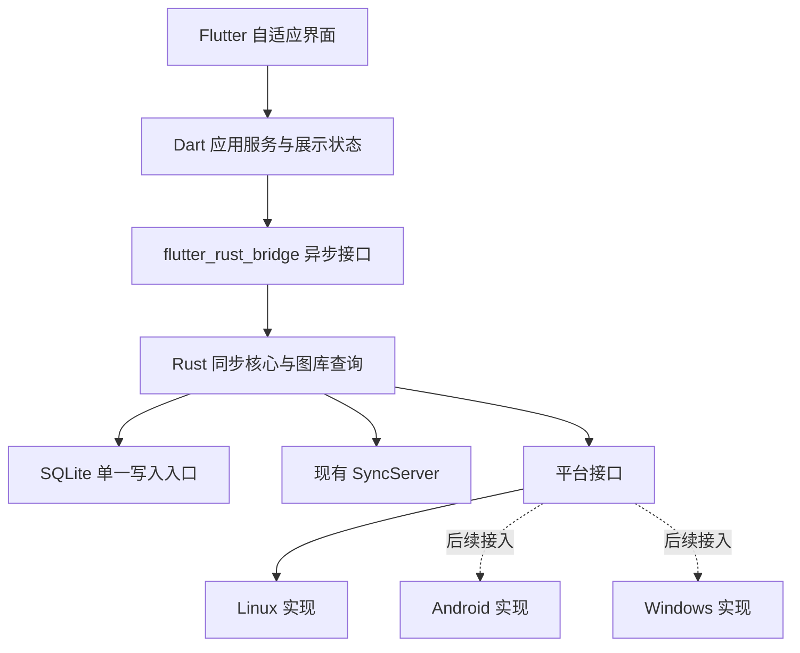

# PhotoViewer 云同步客户端重写方案

> 范围已更新：一期纯本地、云同步二期。当前执行以[本地一期计划](local-first/README.md)为准；本页云同步内容保留作二期设计参考，S01工程基础可复用。二期已按该设计实现双向同步 MVP，实际接入边界、文件布局与限制见[云同步 MVP](cloud-sync-mvp.md)。

日期：2026-10-20。状态：技术方案；尚未实现或验证新客户端。

本方案按最新范围确定：**第一阶段交付 Linux；Android、Windows 从一开始具有可配置的平台边界，之后分别接入。** 产品功能聚焦现有 SyncServer 云同步，以及使用这些照片所必需的浏览、导入和管理。

模块级合同与实施基线见[详细设计索引](design/README.md)。十万张图库性能与液态玻璃UX已纳入首版验收，分别见[M16](design/modules/16-performance.md)与[M17](design/modules/17-liquid-glass.md)。

## 1. 技术决定

采用 **Flutter + Rust + SQLite**：

- Flutter/Dart 重写界面与导航；使用 Riverpod 管理展示状态和应用服务依赖。
- Rust 提供独立于界面和操作系统的同步核心，逐步移植现有协议适配、状态机、持久化与恢复逻辑。
- 使用 flutter_rust_bridge v2 连接 Dart 和 Rust；边界以异步命令、分页查询和事件订阅为主。
- Rust 使用 Tokio、reqwest/rustls、rusqlite；本地 SQLite 由 Rust 单一写入入口管理。
- 平台适配器负责文件来源、凭证、目录位置、媒体处理和运行调度。Linux 先实现；Android、Windows 配置声明为 planned，未实现的能力不能出现在产品操作入口。

不直接依赖现有 PhotoViewer 应用 crate。它的构建和运行仍绑定 GTK、Libadwaita、GStreamer、Blueprint 和平台库；同步协议层已有较好的独立性，但服务和存储仍依赖应用自己的 DbActor、媒体模型、错误类型、缩略图与目录配置。

代码和行为的复用是按模块迁移、测试，再接入新的边界；不能把整个 `src/core/` 换一个 Cargo 名称就视为跨平台核心。

### 备选取舍

| 方案 | 对当前项目的影响 | 决定 |
|---|---|---|
| Flutter + Rust | 重写界面，保留和整理已有 Rust 同步机制；需要维护 FFI 与平台适配 | 采用；同步正确性已有大量实现资产，值得保留 |
| 纯 Flutter/Dart | 界面与业务统一语言；需要再次实现整套同步持久化、租约和崩溃恢复 | 不选作本次主方案；增加协议和恢复行为发生偏差的工作量 |
| Tauri + Rust + Web 界面 | 可保留 Rust；需要建立新的 Web 界面及 WebView 媒体、输入和平台适配方案 | 可行备选；本次优先采用统一的 Flutter 手机、平板与桌面组件体系 |
| 延续 GTK4 UI | 对 Linux 现有界面改造较少；无法满足本项目预定的 Android 界面路线 | 保留为旧客户端，不作为新客户端 UI 基础 |

这些是结合现有代码的工程选择，不是对框架性能高低的基准结论。

## 2. 两个现有项目的核查结果

本次读取的工作区：

| 项目 | 分支与版本 | 当前工作区 |
|---|---|---|
| `../photoViewer` | `main`，`92b533db3f535e4ff0b145784fff70760fe111d7` | 核查时无未提交改动 |
| `../syncserver` | `main`，`f82ca49e245d9f75a195e940dddb47cb761587b1` | 核查时无未提交改动 |
| 当前 `client` | 开始时为空目录，不属于 Git 仓库 | 本次只新增方案文档 |

这些是本地源码核查结果，不代表重新执行过旧客户端测试、远端 CI 或线上部署验证。

### 2.1 PhotoViewer 的云同步

当前应用是 Rust/GTK4/Libadwaita 桌面程序。以下机制已经有源码实现，不能因为部分架构文档仍保留“待接入”文字而误判为未开发：

| 能力 | 主要实现位置 | 新客户端处理 |
|---|---|---|
| 账号登录、能力探测、同源传输 | `src/core/sync/native/{auth,protocol,provider}.rs` | 优先整理迁移；密码只用于登录，会话经平台凭证服务保存 |
| 首次共享快照、分类型分页与增量 | `native/receive.rs`、`service/receive.rs` | 保留固定水位与持久接收进度 |
| 照片与原图/缩略图关系校验 | `native/records.rs` | 保留照片身份、Master 引用和 generation 校验 |
| 上传租约、保活、阶段与回执 | `native/{lease,modify}.rs`、`service/coordinator.rs` | 保留，解除对旧应用服务的依赖 |
| 双资源传输、摘要核验 | `native/assets.rs`、`sync/content.rs` | 保留流式处理；文件来源改为平台边界 |
| 发布意图、替换、启动恢复 | `service/transfer.rs`、`store/publication.rs`、`publication_io.rs` | 保留恢复语义，重做适合受管图库的文件布局与读取保护 |
| dirty、类别版本与未知结果 | `store/{dirty,issued,runtime}.rs` | 保留有效成功确认规则 |
| 同步界面、缩略图加载、目录选择 | `src/ui/`、旧媒体与缩略图模块 | 重写 Flutter UI 和平台媒体适配 |

当前同步模块以 Native SyncServer 为入口；[当前客户端说明](../../photoViewer/docs/modules/native-sync.md)明确原 WebDAV 引擎已移除。本次重写只对接 Native SyncServer。

当前重要产品行为包括：

- 同时只有一个当前同步账号，历史账号配置可以独立保留。
- 上传范围必须明确选择；未选择相册不能被解释为允许上传整个目录。
- 同步触发后先完成下行协调，再处理上行；上传阶段为删除、修改、新增。
- 同一照片身份的双端修改按类别事件时间、来源和事件 ID 确定结果；同路径不意味着同身份。
- 新照片只有原图、缩略图及本地发布都完成才进入图库；更新失败时保留上一完整版本。
- 超时不能当作服务端未提交；下一轮先核实已发出操作的回执，再决定重发。
- 当前桌面自动同步以本地变更停止 10 秒为触发点，没有空闲定时轮询；启动恢复遗留工作与主动新一轮同步是不同操作。
- 现有界面没有开放所有底层云端删除能力；新客户端必须单独定义用户操作与云端变更的映射。

依据：[使用与运行边界](../../photoViewer/docs/modules/native-sync-usage.md)、[协议接入](../../photoViewer/docs/modules/native-sync-protocol.md)、[结构化持久化](../../photoViewer/docs/modules/native-sync-relational.md)。

### 2.2 SyncServer 的现有边界

SyncServer 是 Rust/Axum 服务，已有用户会话和账户隔离、固定快照与增量、条件记录写入、租约/fence、操作回执、原图/缩略图资源和空间配额接口。

本次核对 `src/api/mod.rs` 中的路由与 capabilities：普通用户具备照片同步能力；管理员账号不具备照片图库能力。新客户端必须用登录后的能力探测决定是否允许建立同步关系，不能把管理账号登录成功当成照片同步就绪。

当前声明 `protocolVersion=1`、`checksumAlgorithm=SHA256`、`photoPublication=true`（普通用户），`uploadResume=false`、`sharing=false`。下载支持单段 Range；它与上传断点续传是不同能力，首版不能把上传重试标为断点续传。

云端照片由一对 `CPLAsset` / `CPLMaster` 以及同一 generation 的双资源构成。逻辑相册首先按 `relativePath` 分组，不据此宣称已有独立相册对象同步或共享相册协议。

**协议唯一来源继续在 SyncServer；新客户端只维护映射和接入方案。** 入口：

- [认证与账户隔离](../../syncserver/docs/contracts/authentication.md)
- [快照与增量](../../syncserver/docs/contracts/snapshots.md)
- [记录条件写入](../../syncserver/docs/contracts/records.md)
- [照片记录与逻辑路径](../../syncserver/docs/contracts/photo-records.md)
- [资源、摘要和 Range](../../syncserver/docs/contracts/assets.md)
- [上行协调与成功确认](../../syncserver/docs/contracts/upload-coordination.md)
- [空间配额](../../syncserver/docs/contracts/storage-quota.md)

## 3. 分层与数据所有权



职责约束：

1. UI 只提交用户意图、分页读取图库、订阅变更，不直接修改 SQLite 或操作同步 token。
2. Rust 核心拥有同步状态、dirty、进度、回执、文件发布与恢复；不依赖 Flutter、GTK、GIO 或 GStreamer。
3. 平台层提供环境能力，不另写一套同步状态机。
4. SQLite 不同时交给 Dart ORM 与 Rust 管理；读写接口都经过核心。
5. FFI 不逐张推送全量图库或传输大文件字节；返回分页元数据、稳定 ID 和受管本地媒体引用。事件按批合并，查询结果带账号/配置代际以拒绝过时更新。
6. 原图、缩略图解码及校验在有界后台任务执行；Flutter UI isolate 不承担大图处理。

拟定源码布局，以下路径尚未创建：

```text
client/
  app/                         Flutter 应用，内部含 Linux/Android/Windows runner
    lib/app/                   启动、路由、依赖注入
    lib/features/              账号、图库、查看器、同步状态、设置
    lib/layout/                按窗口宽度选择手机、平板、桌面布局
    lib/platform/              Flutter 侧平台能力接入
  crates/
    photo-domain/              无平台领域类型与ports
    photo-core/                SQLite、同步状态机、媒体目录和恢复
    syncserver-client/         HTTP、DTO、能力探测、资源与租约适配
    photo-bridge/              Flutter API 与事件，薄接口层
    platform-linux/            Linux 文件来源及核心侧平台实现
  platform/
    android/                   后续 Kotlin/JNI/后台与媒体适配
    windows/                   后续 Windows 平台适配
  config/platforms/            平台构建配置
  tools/                       配置校验、生成和打包入口
  docs/
```

首版只在必要边界拆 crate；不为尚无实现的 Android、Windows 创建空 crate 并宣称已经支持。

## 4. 平台可配置的实现方式

“可配置”由三部分组成：**构建配置选择适配器，运行时能力决定可用操作，用户设置选择同步策略。** 它不意味着在 Linux 配置文件里改一个平台名就获得 Android 系统能力。

### 4.1 构建配置

拟用 `config/platforms/{linux,android,windows}.yaml`，经构建工具验证并生成 Dart/Rust 共用的能力描述。示例是设计格式，尚无解析或构建工具：

```yaml
schema_version: 1
profile_id: linux-x86_64
platform: linux
status: active
flutter_target: linux
rust_target: x86_64-unknown-linux-gnu
adapters:
  storage: linux_xdg
  source: linux_file_picker
  secrets: linux_secret_service
  scheduler: while_app_running
  codec: portable_image
  instance_lock: linux_process_lock
limits:
  transfer_parallelism: 4
  original_parallelism: 2
  decoder_parallelism: 2
  decoder_total_mib: 192
  decoder_single_mib: 128
  image_cache_mib: 128
  viewer_cache_mib: 128
  browse_index_mib: 16
  gallery_rows_limit: 2000
  disk_cache_mib: 2048
ui:
  layout: adaptive
  keyboard_mouse: true
  touch: true
packaging:
  format: linux_bundle
```

| 配置项 | Linux 第一阶段 | Android 后续 | Windows 后续 |
|---|---|---|---|
| 配置状态 | active | planned，接入前禁止发布构建 | planned，接入前禁止发布构建 |
| 媒体来源 | 明确选择的目录或文件 | Photo Picker / MediaStore，经权限允许的内容 URI | 目录与文件选择器 |
| 凭证适配 | Secret Service | Android Keystore 支持的令牌加密存储适配 | Windows 凭证存储适配 |
| 数据位置 | XDG 私有目录 | 应用私有持久目录 | 用户应用数据目录 |
| 运行调度 | 应用运行期间 | 系统后台任务与用户发起传输适配 | 先应用运行期间，后续独立扩展 |
| 主要架构 | x86_64 | 优先 arm64，模拟器架构按需单列 | 优先 x86_64 |
| 打包 | Linux bundle | APK/AAB | Windows 安装包 |

构建器必须验证宿主、目标、Rust target、原生插件和实际注册适配器是否匹配。Rust 的目标条件编译和 Flutter 各平台 runner 配置仍需要正常维护；不能把平台判断散布在业务逻辑中。

同一平台可有多份构建 profile，例如 Linux x86_64 与 arm64。平台配置不含服务端密码或会话，也不把某个生产服务地址编译成唯一可连接地址。

### 4.2 运行时平台接口

| 接口 | 责任 | 关键要求 |
|---|---|---|
| `AppStorage` | 受管图库、数据库、暂存和缓存位置 | 持久原图与可回收缓存分开；发布暂存与最终资源满足原子替换前提 |
| `MediaSource` | 枚举用户授权来源，打开稳定可读的内容 | 核心不假设来源一定是 POSIX 路径；可先导入受管快照 |
| `SecretStore` | 保存/读取/删除会话 | SQLite 只存凭证引用；无可用安全存储时明确进入需登录状态 |
| `BackgroundScheduler` | 运行触发、停止信号、时间预算与网络条件 | 核心接收取消/期限并持久化进度，不能依赖永不终止的进程 |
| `MediaCodec` | 缩略图、方向、预览与可用格式 | 核心同步协议与平台编解码解耦；不修改上传原始字节 |
| `PlatformCapabilities` | 汇总已编译且实际可用的能力 | 配置不能凭空启用未实现功能；UI 依据实际能力展示 |

平台接口是职责边界，不强制所有调用都经过 Dart：Linux 原生能力可直接在 Rust 实现；Android 的权限和系统调度需要宿主适配。凭证与媒体句柄通过受控桥接交给核心，避免让所有文件 I/O 绕行 Dart。

### 4.3 用户运行设置

保存服务地址、当前账号、zone、明确的上传范围、暂停状态、网络限制等。保存于客户端结构化数据或普通偏好设置，和构建 profile 分离。

某平台未提供目录监听或后台执行时，使用已实现的手动导入/手动同步操作，界面如实显示能力。不可因为 YAML 中写了 `background: true` 就承诺关闭应用后仍然同步。

## 5. 本地存储与跨平台身份

### 5.1 使用受管图库

新客户端使用独立数据库和私有受管媒体目录，不直接复用旧 PhotoViewer 的数据库，也不对旧用户图库做隐式迁移。

第一阶段 Linux 支持选择目录或文件导入，将需要同步的媒体准备为受管内容快照；原目录作为用户授权来源记录。应用内改动发生在受管副本上。监控原目录并自动追踪外部修改作为单独后续能力，避免首版同时承担旧桌面图库的全部行为。

旧 PhotoViewer 与新客户端可作为两个设备同步同一账户；验证必须覆盖它们同时读写，而不是要求两者共享本地数据库。

### 5.2 分开云端路径与本地物理路径

服务端 `relativePath` 保留逻辑路径语义。本地实际文件使用账户隔离的稳定 ID/内容代际布局，例如：

```text
<account-root>/media/<photo-id>/<content-generation>/original.<safe-extension>
<account-root>/staging/<publication-id>/...
```

具体目录名由客户端生成并验证，不能直接拼接远端输入。云端路径、展示名、来源标识和本地路径分别存储，不将 `content://` URI 当作普通路径，也不以本地文件名作为照片身份。

这样可以为 Windows 的文件名限制、大小写冲突和 Android 的无目录来源保留空间。导出到用户目录时再执行目标平台文件名校验和明确的重名处理；不能悄悄改变云端逻辑路径。

### 5.3 同步状态继续结构化

复用现有模型的概念：账户与连接、任务与范围、`sync_entries` 的 dirty/类别版本、接收记录与字段、接收进度、资源义务、已发出操作、发布意图和冲突证据。

- 云图和恢复状态存普通 SQLite 列及关联表；JSON 只在协议和进程内 DTO 边界使用。
- 索引覆盖账号、job、photo/master ID、逻辑路径、资源身份与待处理状态；常用查询检查实际查询计划。
- 内容替换、回收站状态、路径修改和永久删除分别持久化捕获版本与事件；已绑定照片的本地编辑、改名、移动、回收站/恢复和永久删除都生成对应同步义务，不另建第二份待办队列。
- 已发出操作的 UUID、规范化请求和版本捕获属于结果未知的恢复证据，不能和 dirty 混为一谈。
- 新客户端建立自身有序 schema 迁移；不机械继承旧开发项目固定 `user_version=1` 的策略。
- 账号目录、查询和凭证引用相互隔离；切换时撤销旧运行代际，旧响应不能应用到新账号。

### 5.4 图片可见性与存储压力

第一阶段保留现有完整副本模式：每张新照片的原图和缩略图校验、发布完成后才进入图库。不加入只有缩略图的普通图库占位，也不宣称原图按需下载已经支持。

这意味着未来手机接入时需要为已同步照片保存原图；空间不足时暂停传输、显示未完成数量并保留恢复状态。只下载预览、选择性离线等需要单独产品与协议接入方案，不作为第一阶段的隐含能力。

原图放持久数据目录，不能放系统可能清理的缓存目录。可重建缩略图缓存被清理后需要重新核对实际就绪状态，不能只依赖历史完成计数。

## 6. 必须保留的同步正确性

1. 首次各记录类型共享同一个快照水位；分页并发变化不能混进同一轮清单。
2. 接收进度和完整应用进度分离；保存了元数据不代表照片已经完整发布。
3. 照片身份、Master 引用、generation、原图摘要与缩略图来源一致后才发布。
4. 原图和缩略图的文件替换与 SQLite 不构成一个事务，必须持久化发布意图并支持启动恢复。
5. 上传前获取服务器租约，持锁核对最新进度并补拉；按删除、修改、新增阶段执行。
6. 失锁停止当前与后续未完成上行；旧 fence、旧配置、旧轮次或迟到响应不能清 dirty。
7. 已提交但响应未知时优先读取提交事实；不重新生成逻辑操作身份来碰运气。
8. 成功确认核对本地类别版本；上传期间发生的新编辑继续保持待同步。
9. 单项业务/资源失败保留原因并跳过本轮该项，允许独立照片继续；租约或协议安全失败终止本轮。
10. 同身份冲突沿用按类别事件排序的决定规则并保护冲突内容；不同身份的路径冲突另行处理。
11. 未选择上传、来源丢失、移出范围和仅移除本地副本都不自动转化为云端永久删除。
12. 保留 INFO 批次日志及 complete/pending/partial/deferred 的明确含义，凭证始终脱敏。

新 UI 区分“移入回收站/恢复”“从云端永久删除”“仅删除本地副本/导出”等意图。回收站/恢复是 `isTrashed` 元数据义务，不读原图也不上传资源；永久删除先在本地写墓碑并进入 Delete 阶段，服务端确认或确认远端已不存在后才移除绑定与本地行。绑定照片的编辑、改名和移动相册同样上行，不再有只读限制；未选择上传、来源丢失或移出范围不会自动转化为云端永久删除。

## 7. 自适应 UI

第一阶段实现并在 Linux 上验证三种窗口宽度，不把平台名称当成布局选择依据：

| 可用逻辑宽度 | 导航与页面 |
|---|---|
| 小于 600 | 手机布局：底部导航，图库和详情为独立页面 |
| 600–1023 | 平板布局：侧边 NavigationRail，按空间选择双栏 |
| 1024 及以上 | 桌面布局：侧栏、图库与可选详情区域 |

这些是项目初始断点，依据实际控件和窗口验证调整。共享页面、选择状态和操作服务，避免维护三套业务界面。输入支持鼠标、键盘与触摸；缩放、全屏查看和返回行为需要分别验证。

首版页面：登录/连接、照片网格、按云端逻辑路径分组、照片查看、同步概览与设置。设置围绕当前账号；暂停/继续/立即同步与详情展开使用独立操作，账号配置保留草稿确认边界。

网格虚拟化、按页读数据库、按可见尺寸加载本地缩略图；缩略图解码设置目标尺寸和并发上限，不一次将全部原图加载到内存。

图片格式先验证 JPEG/PNG/WebP 和 EXIF 方向。HEIC/HEIF、RAW 与视频作为独立媒体能力：保留原字节传输的可能性，另行验证预览、缩略图生成和平台解码，不把“能上传文件”视为完整支持该格式。

## 8. Linux 第一阶段的实施顺序

L0–L3以下为总体阶段；具体执行已拆成[14个开发检查点](design/development-plan.md)，每点有[独立验收步骤](design/stage-acceptance.md)。先在S03/S04验证本地玻璃和十万浏览，再开发真实同步，最终S13/S14综合复验并安装交付。

### L0：工程与跨平台边界验证

搭建 Flutter Linux runner、独立 Rust workspace 和 FFI；建立 profile 校验/选择、能力查询、核心初始化与关闭、账号代际事件。

实现 Linux 的 AppStorage、SecretStore、MediaSource 和应用运行期间调度。用临时测试数据完成 Rust 查询、Flutter 展示、异步事件和停止恢复；确认核心不拉入旧 GTK 应用依赖。

交付：可启动 Linux 窗口、真实加载 Rust 核心、平台配置生效；Android/Windows 为明确的 planned 状态，无虚假支持标志。

### L1：登录与可靠下行

移植认证、能力验证、快照/增量、结构化接收、双资源下载与发布恢复。先打通查看云端完整照片，不同时开展全部本地媒体功能。

交付：Linux 登录普通用户账号，可逐张完成下行并浏览；离线仍可查看已完成副本；错误、进度和待办真实可见。

### L2：导入与可靠上行

加入文件/目录显式导入、允许上传范围、原图和同源缩略图准备、租约/阶段/条件写入/回执恢复，以及收藏等已支持元数据操作。

交付：新客户端上传后旧 PhotoViewer 能下行；旧客户端上传或修改后新客户端能接收；暂停、取消、重新登录和重启不丢工作。

### L3：Linux 首版验收与打包

完善同步设置、空间不足/配额/认证错误呈现、列表批次更新、自适应布局、真实输入和 Linux bundle。

先在当前 Fedora x86_64 桌面验证实际运行，再以选定 Linux CI 环境补充检查。其他发行版和架构按明确支持矩阵扩展，不以一次本机启动代表所有 Linux 环境已兼容。

Linux 首版完成的最低条件：

- 可安装/启动，能使用正常账号连接现有 SyncServer，管理员账号得到准确提示。
- 首次同步、增量与重启恢复可运行，完整照片可浏览。
- 显式导入并上行双资源，收藏等元数据只更新必要记录。
- 账号切换、暂停/继续、未知结果恢复、双端竞争和配额错误具有可验证行为。
- Linux 上三种宽度均能完成主要操作；这不替代将来的 Android 真机验收。
- 提供实际打包产物和验证记录，区分聚焦测试、完整检查与远端 CI。

## 9. Android、Windows 的后续接入

平台接入以新增已注册适配器并通过验收为条件。后续不重写同步算法和数据库业务。

### Android

将 Android profile 从 planned 转为 active 前，需要完成：Flutter runner 与 Rust arm64 构建；系统照片选择/权限和内容 URI 适配；受管持久目录；凭证加密存储；网络/存储条件；后台触发与停止恢复；手机/平板真机输入和内存验证。

Android 的运行调度需要独立宿主设计：UI 通过 FFI 使用核心，后台任务通过原生适配调用同一核心。必须验证同进程实例共享和跨入口排他，避免两个 writer 或两个同步引擎同时操作同一账号。后台入口是否采用 JNI 及如何初始化需在 Android 接入阶段先做最小验证，不能假设关闭 Flutter 页面后 Rust 就天然获得后台运行资格。

长传输、自动照片发现和系统任务调度须按接入时 Android 官方规则实现；应用被系统停止后不承诺持续执行。当前不绑定未经验证的后台时限或库版本。

### Windows

将 Windows profile 转为 active 前，需要完成 Windows runner / Rust target / 打包，凭证存储、目录选择和文件占用适配；检验本地替换、大小写及导出文件名。核心不使用 Unix inode 作为跨平台身份。

Linux 已建立的逻辑路径/物理路径分离、取消边界和发布恢复语义必须延续；原生文件替换具体实现通过目标平台适配验证。

## 10. 验证计划与性能目标

实现时采用四层证据：核心聚焦测试、真实 SyncServer 协议旅程、Flutter 组件/集成测试、打包后的真实 Linux 输入与渲染。

优先迁移现有 `native_sync_receive`、`native_sync_assets`、`native_sync_lease`、`native_sync_accounts` 等测试中的关键场景；其中已有测试辅助代码依赖 Unix 文件权限与旧应用初始化，需要改造，不能原封不动作为跨平台验收。

关键旅程包括：快照分页期间并发写入、页面重放、仅一个资源完成、错误摘要、发布过程中终止、响应丢失后重启、编辑与成功回调竞争、两设备抢租约、账号切换后的迟到回调、空间不足和配额耗尽。

性能验收分开定义：

- 已有本地完整资源的 100 条照片元数据批次，在明确的本机服务、设备和构建条件下，以请求开始到持久化、应用和 checkpoint 完成不超过 1 秒为验收目标；记录各组成耗时。
- 包含原图下载的旅程按字节量、吞吐、并发、内存与恢复开销测量，不纳入同一个 1 秒保证。
- 图库按100,000张边界验证首屏、rank跳转、连续滚动、内存和同步并行；默认液态玻璃及full固定质量都测，目标与数据集见M16/M17，不以调试模式体感代替正式测量。

旧项目文档中的 100 条批次成绩属于旧实现的历史验证，不是新客户端已经达到的结果。

## 11. 资料与本次验证边界

已通过官方页面核对 Flutter 的目标平台、自适应布局建议、flutter_rust_bridge 的跨平台边界与 Tauri 的 WebView 架构。参考入口如下，后续实现锁定实际测试的 SDK/包版本与 lockfile：

- Flutter 平台：`https://docs.flutter.dev/reference/supported-platforms`
- Flutter 自适应布局：`https://docs.flutter.dev/ui/adaptive-responsive/general`
- flutter_rust_bridge：`https://cjycode.com/flutter_rust_bridge/`
- Tauri：`https://v2.tauri.app/start/`

Android 官方后台任务、Photo Picker 和 Keystore 页面在本次访问中超时；相关适配保留为设计边界，接入阶段重新核对系统 API 与适用版本，不据此宣称 Android 已验证。

本机已发现 Rust/Cargo、Java、adb、Ninja 与 Clang；当前 PATH 未发现 Flutter、Dart、CMake。这里只表示命令发现结果，不代表全部开发环境已安装或已诊断。第一项实施工作应完成 Linux Flutter 工具链和 FFI 的实际构建验证。

本次没有编译新应用，没有运行旧项目测试，也没有修改旧客户端、服务器、线上数据或部署。
