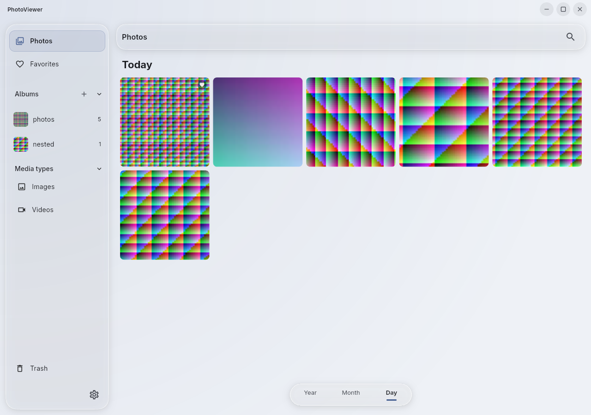
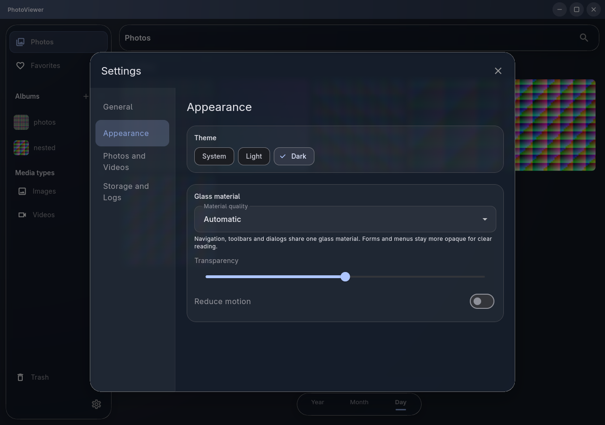
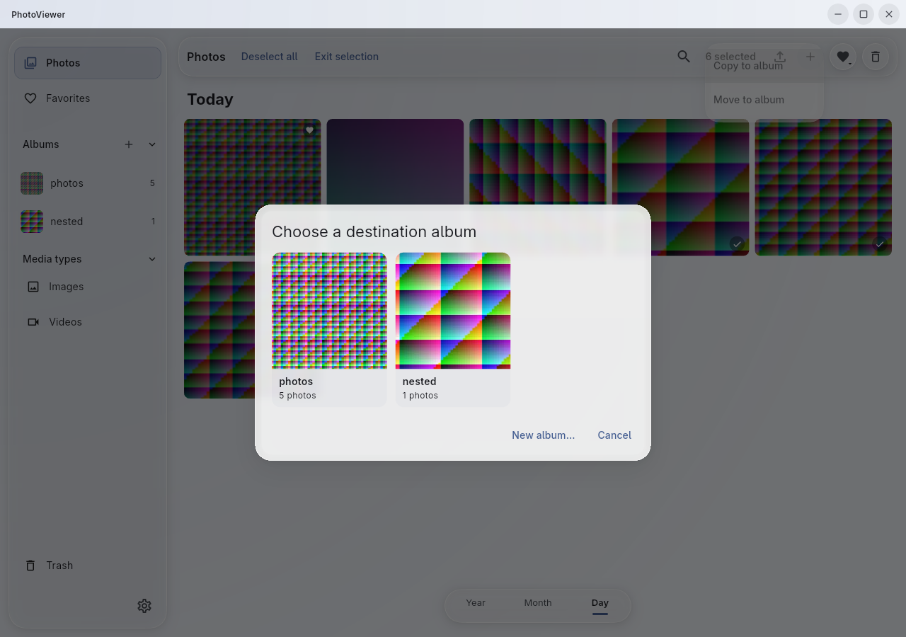

# 统一玻璃 UX：2026-10-21

本轮对照相邻 `photoViewer/docs/modules/ui-liquid-glass.md` 和旧客户端的视觉契约，只修改 Flutter 客户端。

旧客户端将导航、弹窗、菜单、详情与编辑面板纳入共享材质。迁移后的客户端只有 Chrome/Reading 两种角色：侧栏和页头贴边、默认 Material 弹窗与菜单大量存在，设置/文件选择还在默认 Dialog 内嵌自己的材质。玻璃分段器与这些入口的圆角、选中和表单样式未统一。

## 修改

| 范围 | 当前实现 |
| --- | --- |
| 共享主题 | `GlassTheme` ThemeExtension 管理颜色、边缘、阴影、分组和选中；按钮、输入框、Chip、ListTile 与提示复用主题形状。 |
| 材质层级 | Chrome 用于导航，Raised 用于浮动操作，Overlay 用于弹窗/菜单/详情/编辑，Reading 保留高不透明度正文路径。各角色统一接受透明度与高对比设置。 |
| 窗口与导航 | 静态低饱和背景；圆角侧栏与工具栏留出外边距；普通导航和相册行共享选中与按压反馈。 |
| 弹窗 | 设置、文件选择、快捷键、删除确认、重命名、新建相册、选择相册、照片详情统一经过 `GlassDialog`/`GlassAlertDialog`；保留系统路由的焦点、Esc、点外关闭和输入法避让。 |
| 菜单 | 一个材质包围整组菜单项；继续使用 Flutter 菜单路由定位与键盘导航。右键照片、右键相册与批量相册操作统一。 |
| 相册选择 | 真实缩略图封面、名称和数量组成网格；长列表滚动，少量相册按实际行数收缩；保留新建/取消入口。 |
| 查看与编辑 | 查看器页头与胶片条采用 Raised，详情和编辑面板采用 Overlay；面板圆角/间距一致，减少动画时禁用详情滑入。 |
| 搜索 | 范围切换与年月日采用单容器加文字/短指示线；输入框保留自己的焦点，不叠默认表单边框。 |

照片网格与封面不增加滤镜，侧栏行与设置分组复用父级材质。大面板使用 standard 路径，premium 捕获仅用于小范围焦点控件（年月日、查看器页头）；不增加全屏动态模糊或背景动画。普通/完整模式仍由原有自适应范围约束。

## 验证

- Flutter analyze：无问题。
- 15 项现有测试通过，涉及 390/800/1440 宽度浏览、收藏、选择、删除恢复、相册操作、搜索、编辑、快捷键、窗口控制、Reading 安全下限和高对比。未新建测试用例。
- 后续真实桌面 dev 复核发现设置分组的装饰背景会遮挡 ListTile 墨水层；已改用 Material 承载分组和分类背景。只新增并运行 `settings_material_test.dart` 这一项相关回归，验证四个设置分类及快捷键弹窗交互通过，未重跑此前用例或全量测试。
- Linux debug 构建成功；本机缺少 libheif 开发链接名，通过忽略目录中的本地链接与构建环境变量解决，未修改系统包或构建源码。
- 使用隔离 Xvfb 窗口、合成图片与独立数据库检查实际布局。自动模式有效档位为 standard，渲染器是 Impeller/OpenGLESSDF，Mesa 软件渲染；截图不证明物理 GPU 的 premium 折射效果或性能。
- 旧 provision 旅程通过扫描、网格、查看器、元数据和收藏持久化后，在 `library-summary-text` 停止：该旧断言要求照片总览始终挂载，而当前项目此前已改为按需展开。本轮未改这一行为，因此不宣称完整旅程通过；framework 输入也未验证搜索打字。

完整记录、日志与截图见[验证记录](../verification/local-features/glass-ux-unification/report.json)。十万张性能、完整模式物理 GPU 检查与跨平台发布仍需单独验收。

## 界面

另有[浅色设置](../verification/local-features/glass-ux-unification/settings-light.png)、[菜单](../verification/local-features/glass-ux-unification/menu-light.png)、[详情](../verification/local-features/glass-ux-unification/details-dark.png)、[编辑器](../verification/local-features/glass-ux-unification/editor-dark.png)和[窄窗设置](../verification/local-features/glass-ux-unification/settings-compact.png)。
